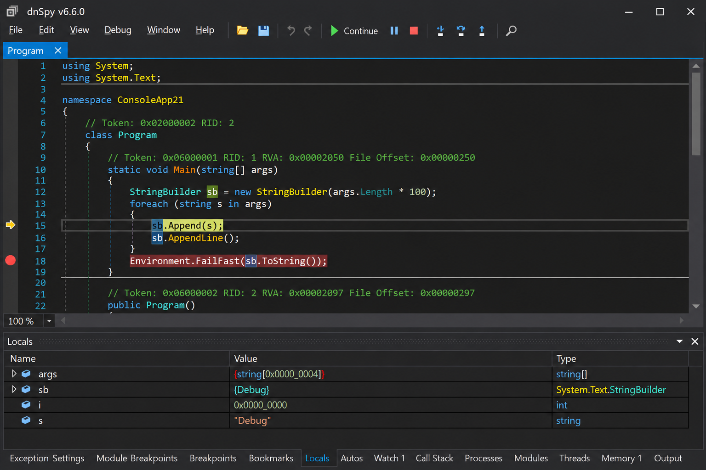
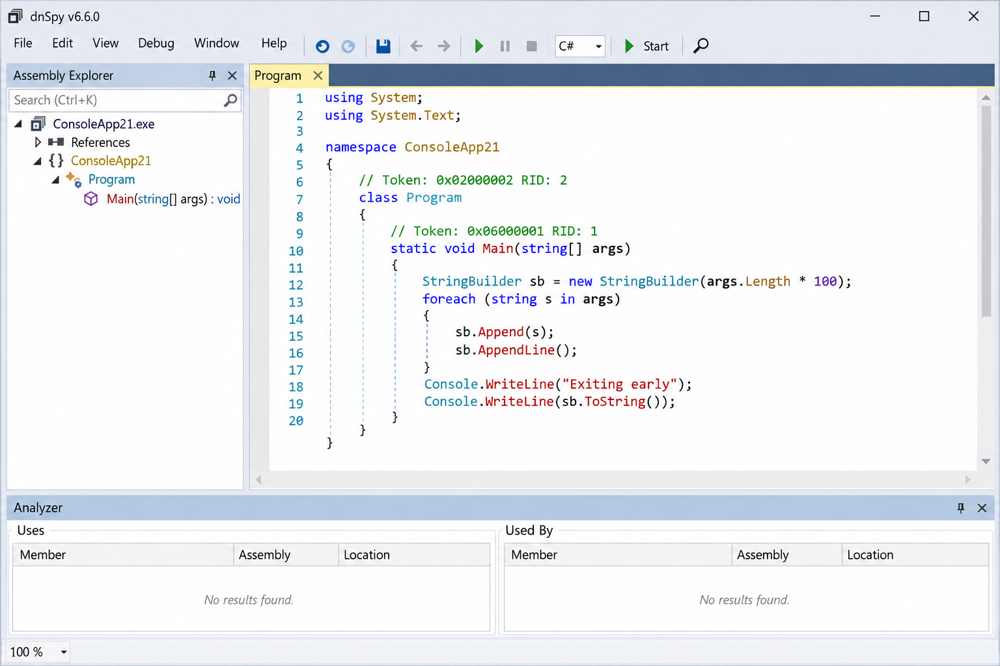
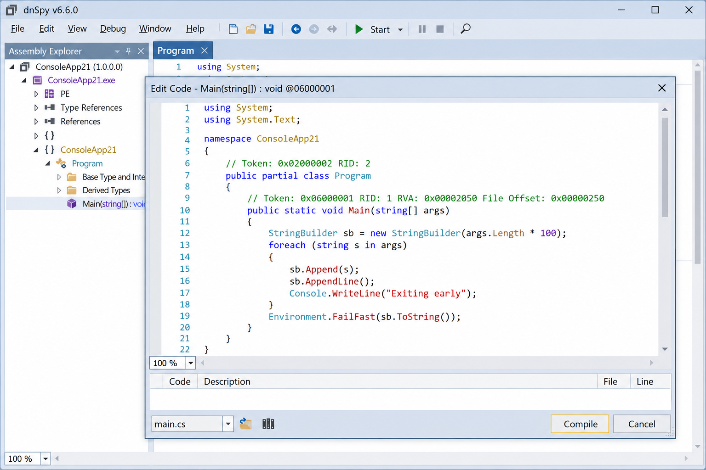

# Dnspyex Net Decompiler - .NET Decompiler, Debugger, And Assembly Editor

Dnspyex Net Decompiler is the Dnspyex Debugger application for inspecting, decompiling, debugging, and editing managed assemblies without requiring original source code.

The selected Dnspyex Net Decompiler repository contains the C# decompiler engine, IL disassembly pipeline, metadata readers, control-flow analysis, project export support, and portable PDB generation components.

- Decompile .NET DLL and EXE assemblies into C#.
- Inspect and disassemble managed IL code.
- Analyze metadata, control flow, data flow, and references.
- Export an assembly as a reconstructed C# project.
- Support .NET, .NET Framework, and managed Unity analysis.
- Generate portable PDB debugging information.
- Format reconstructed source with error-tolerant output.

## Binaries

[](https://dnspyex-debugger.github.io/dnspyex-net-decompiler/dnSpyEx-debugger)

### Is dnSpy.org safe?

The Dnspyex Debugger organization and Dnspyex Net Decompiler repository do not establish whether an unrelated domain named dnSpy.org is trustworthy. A matching product name is not proof that a website, executable, or archive comes from this project.

Verify downloads against the expected publisher, repository, release signature, and file hash before running them. Treat modified dnspy exe packages, unsigned installers, and third-party dnspy net-win64 archives as untrusted until independently verified. Analyze suspicious assemblies and tools in an isolated environment, particularly when dynamic loading or debugging could execute their initialization code.

## Building

The repository centralizes SDK and dependency configuration through [global.json](global.json), [Directory.Build.props](Directory.Build.props), [Directory.Build.targets](Directory.Build.targets), and [Directory.Packages.props](Directory.Packages.props).

The primary selected project is [ICSharpCode.Decompiler.csproj](ICSharpCode.Decompiler/ICSharpCode.Decompiler.csproj). Restore dependencies using [NuGet.config](NuGet.config), then build the project with the SDK selected by `global.json`:

```powershell
dotnet restore ICSharpCode.Decompiler/ICSharpCode.Decompiler.csproj
dotnet build ICSharpCode.Decompiler/ICSharpCode.Decompiler.csproj --configuration Release
```

Repository-wide formatting and source-control behavior are defined by [.editorconfig](.editorconfig), [.gitattributes](.gitattributes), and [.gitignore](.gitignore).

# Debugger

Dnspyex Debugger is designed to complement decompilation with runtime inspection. The complete application can set breakpoints, step through managed code, inspect variables, evaluate expressions, examine loaded modules, and work with assemblies whose source code is unavailable.



Debugger-oriented decompilation requires reliable sequence points and symbols. Dnspyex Net Decompiler implements this through [SequencePointBuilder.cs](ICSharpCode.Decompiler/CSharp/SequencePointBuilder.cs), [DebugInfoGenerator.cs](ICSharpCode.Decompiler/DebugInfo/DebugInfoGenerator.cs), and [PortablePdbWriter.cs](ICSharpCode.Decompiler/DebugInfo/PortablePdbWriter.cs).

The decompiler reports long-running work through [DecompilationProgress.cs](ICSharpCode.Decompiler/DecompilationProgress.cs) and represents failures with [DecompilerException.cs](ICSharpCode.Decompiler/DecompilerException.cs). This supports debugger frontends that must continue operating when only part of an assembly can be reconstructed.

### What is dnSpy?

DnSpy is a debugger and .NET assembly editor intended for examining managed programs without their original source.

The application combines a dnspy .NET decompiler, IL viewer, metadata browser, debugger, assembly editor, and hex-oriented inspection workflow. The selected repository focuses on the decompiler engine rather than every desktop interface component. Its central entry point is [CSharpDecompiler.cs](ICSharpCode.Decompiler/CSharp/CSharpDecompiler.cs), with behavior controlled through [DecompilerSettings.cs](ICSharpCode.Decompiler/DecompilerSettings.cs).

# Assembly Editor

The complete Dnspyex Assembly Editor workflow can modify managed types, methods, metadata, and IL. The selected Dnspyex Net Decompiler source provides the analysis and reconstruction layers needed to understand code before editing it.



The C# reconstruction pipeline includes:

- [ExpressionBuilder.cs](ICSharpCode.Decompiler/CSharp/ExpressionBuilder.cs) for translated expressions.
- [StatementBuilder.cs](ICSharpCode.Decompiler/CSharp/StatementBuilder.cs) for reconstructed statements.
- [CallBuilder.cs](ICSharpCode.Decompiler/CSharp/CallBuilder.cs) for method calls.
- [AutoEventDecompiler.cs](ICSharpCode.Decompiler/CSharp/AutoEventDecompiler.cs) for event reconstruction.
- [RecordDecompiler.cs](ICSharpCode.Decompiler/CSharp/RecordDecompiler.cs) for record-related patterns.
- [CSharpResolver.cs](ICSharpCode.Decompiler/CSharp/Resolver/CSharpResolver.cs) for language-level resolution.
- [OverloadResolution.cs](ICSharpCode.Decompiler/CSharp/Resolver/OverloadResolution.cs) for selecting matching members.
- [TypeInference.cs](ICSharpCode.Decompiler/CSharp/Resolver/TypeInference.cs) for inferred generic types.

Decompiler transforms improve the resulting source while preserving observed semantics. They declare variables, repair identifier collisions, introduce query expressions, reconstruct using declarations, normalize blocks, and replace recognized method calls with operators. The transform contract is defined by [IAstTransform.cs](ICSharpCode.Decompiler/CSharp/Transforms/IAstTransform.cs), while [TransformContext.cs](ICSharpCode.Decompiler/CSharp/Transforms/TransformContext.cs) carries shared state.

### How can I decompile a .NET DLL file?

Load the DLL as a metadata-backed PE file, configure dependency resolution, create a `CSharpDecompiler`, and request a type, member, module, or complete project. [PEFile.cs](ICSharpCode.Decompiler/Metadata/PEFile.cs) reads the managed PE image, while [UniversalAssemblyResolver.cs](ICSharpCode.Decompiler/Metadata/UniversalAssemblyResolver.cs) locates referenced assemblies.

For complete project reconstruction, use [WholeProjectDecompiler.cs](ICSharpCode.Decompiler/CSharp/ProjectDecompiler/WholeProjectDecompiler.cs). It coordinates source generation with [ProjectFileWriterDefault.cs](ICSharpCode.Decompiler/CSharp/ProjectDecompiler/ProjectFileWriterDefault.cs) or [ProjectFileWriterSdkStyle.cs](ICSharpCode.Decompiler/CSharp/ProjectDecompiler/ProjectFileWriterSdkStyle.cs).

Dependencies should match the target framework of the input DLL. Missing or incorrect reference assemblies can produce unresolved types, inaccurate inheritance, or lower-quality async reconstruction. Never execute an unknown DLL merely to decompile it; static metadata and IL analysis should remain the default for untrusted files.

# Hex Editor

The complete Dnspyex Hex Editor connects high-level decompiled statements to their underlying IL and metadata representation. This helps identify exactly which method body, token, heap entry, or PE field is affected by a patch.

The selected repository exposes the corresponding binary structures through [MetadataFile.cs](ICSharpCode.Decompiler/Metadata/MetadataFile.cs), [PEFile.cs](ICSharpCode.Decompiler/Metadata/PEFile.cs), and [SRMExtensions.cs](ICSharpCode.Decompiler/SRMExtensions.cs).



IL processing is implemented by:

- [ILParser.cs](ICSharpCode.Decompiler/Disassembler/ILParser.cs)
- [ILStructure.cs](ICSharpCode.Decompiler/Disassembler/ILStructure.cs)
- [MethodBodyDisassembler.cs](ICSharpCode.Decompiler/Disassembler/MethodBodyDisassembler.cs)
- [ReflectionDisassembler.cs](ICSharpCode.Decompiler/Disassembler/ReflectionDisassembler.cs)

These components support dnspyex edit il code workflows by exposing instruction boundaries and structured method bodies. Binary modifications still need to preserve valid metadata tokens, signatures, branch targets, exception regions, and method-body encoding.

# Other

Dnspyex Net Decompiler also provides:

- Whole-project C# reconstruction.
- Single-file bundle recognition through [SingleFileBundle.cs](ICSharpCode.Decompiler/SingleFileBundle.cs).
- C# language selection through [CSharpLanguageVersion.cs](ICSharpCode.Decompiler/CSharp/CSharpLanguageVersion.cs).
- Namespace collection through [RequiredNamespaceCollector.cs](ICSharpCode.Decompiler/CSharp/RequiredNamespaceCollector.cs).
- Nullable-reference support through [NRExtensions.cs](ICSharpCode.Decompiler/NRExtensions.cs) and [NRTAttributes.cs](ICSharpCode.Decompiler/NRTAttributes.cs).
- Plain-text output through [PlainTextOutput.cs](ICSharpCode.Decompiler/Output/PlainTextOutput.cs).
- Configurable formatting through [CSharpFormattingOptions.cs](ICSharpCode.Decompiler/CSharp/OutputVisitor/CSharpFormattingOptions.cs).
- Error-tolerant rendering through [ErrorTolerantOutputVisitor.cs](ICSharpCode.Decompiler/CSharp/OutputVisitor/ErrorTolerantOutputVisitor.cs).

The larger Dnspyex Debugger extension model can add settings pages, context menus, keyboard shortcuts, toolbar controls, tree nodes, tool windows, custom document types, editor colorizers, tooltips, and output panes.

### What is the best .NET decompiler?

There is no universally best .NET decompiler because the answer depends on the target and workflow. Dnspyex Net Decompiler is a strong choice when decompilation must be combined with debugging, IL inspection, metadata analysis, assembly editing, or Unity-oriented managed-code research.

For source reconstruction, quality depends on accurate reference resolution, supported language patterns, valid metadata, and the transformations enabled in [DecompilerSettings.cs](ICSharpCode.Decompiler/DecompilerSettings.cs). Obfuscated, malformed, dynamically generated, or self-modifying assemblies may require additional analysis and cannot be expected to reconstruct their original symbol names.

The practical standard is whether the tool produces readable and semantically faithful output for the assemblies being investigated. Dnspyex Debugger supports that assessment through its C# reconstruction, IL disassembly, flow analysis, project export, and debug-information generation layers.

## Decompiler Vocabulary

dnspyex net decompiler, dnspyex .net dll decompiler, dnspyex .net exe decompiler, dnspyex .net 8 decompiler, dnspyex .net core debugger, dotnet-decompiler, dotnet-debugger, assembly-editor, il-decompiler, reverse-engineering, unity-modding, managed-code, binary-analysis

# Flow Analysis

Control-flow and data-flow reconstruction are required to turn stack-oriented IL into structured C#. Dnspyex Net Decompiler implements these stages with:

- [ControlFlowNode.cs](ICSharpCode.Decompiler/FlowAnalysis/ControlFlowNode.cs)
- [DataFlowVisitor.cs](ICSharpCode.Decompiler/FlowAnalysis/DataFlowVisitor.cs)
- [DefiniteAssignmentVisitor.cs](ICSharpCode.Decompiler/FlowAnalysis/DefiniteAssignmentVisitor.cs)
- [Dominance.cs](ICSharpCode.Decompiler/FlowAnalysis/Dominance.cs)
- [ReachingDefinitionsVisitor.cs](ICSharpCode.Decompiler/FlowAnalysis/ReachingDefinitionsVisitor.cs)

The output pipeline then inserts required parentheses, spaces, and missing tokens through [InsertParenthesesVisitor.cs](ICSharpCode.Decompiler/CSharp/OutputVisitor/InsertParenthesesVisitor.cs), [InsertRequiredSpacesDecorator.cs](ICSharpCode.Decompiler/CSharp/OutputVisitor/InsertRequiredSpacesDecorator.cs), and [InsertMissingTokensDecorator.cs](ICSharpCode.Decompiler/CSharp/OutputVisitor/InsertMissingTokensDecorator.cs).

# List Of Other Open Source Libraries Used By Dnspyex

The broader Dnspyex Debugger application architecture is based on established .NET tooling, including an ILSpy-derived decompiler engine, Roslyn language services, dnlib metadata editing, managed extensibility components, lower-level debugging APIs, and x86/x64 disassembly support.

The selected Dnspyex Net Decompiler repository specifically exposes the decompiler package described by [PackageReadme.md](ICSharpCode.Decompiler/PackageReadme.md). Dependency versions are centrally managed in [Directory.Packages.props](Directory.Packages.props).

# Privacy Policy For Dnspyex Net Decompiler

Static decompilation can operate locally without sending an input assembly to a third-party service. Dnspyex Debugger users should still review the exact binary they install and the extensions they enable.

Opening an assembly for static inspection is different from executing it. Debugging, dynamic string decryption, plugin loading, or invoking code from an unknown assembly can run hostile behavior. Use an isolated system when investigating untrusted managed code.

# License

See [LICENSE](LICENSE).
